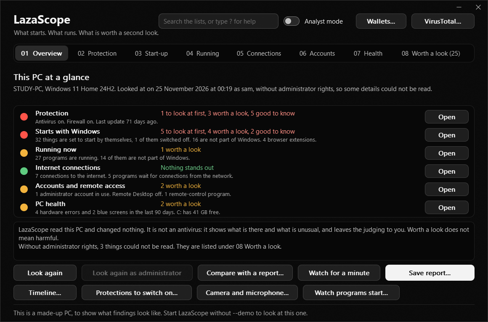
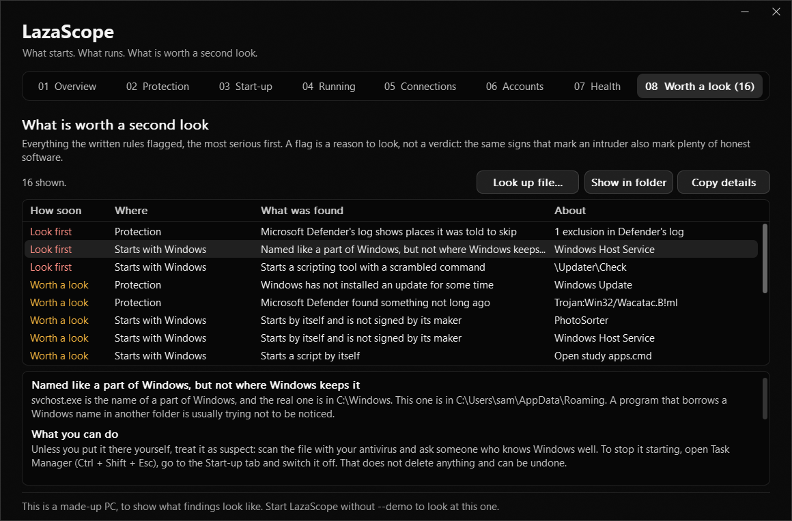
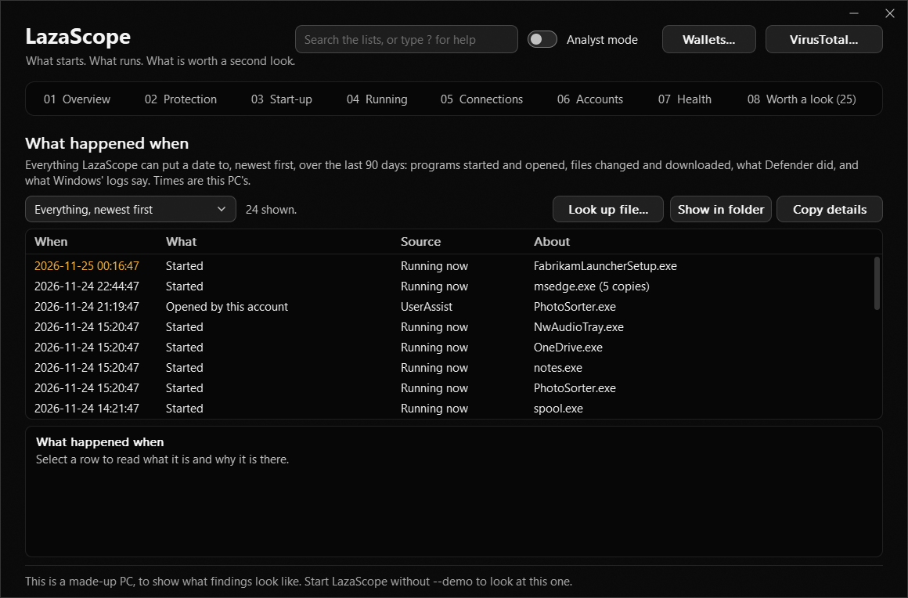
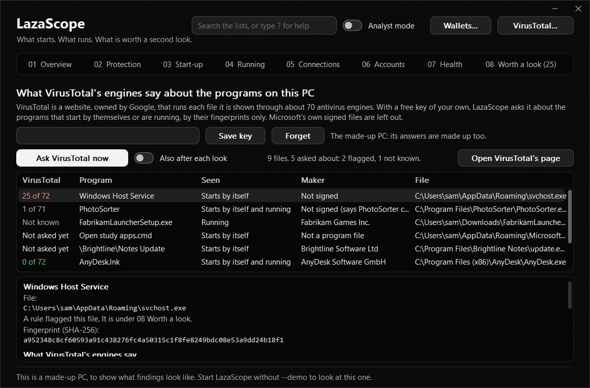

# LazaScope

LazaScope is a free, portable Windows program that shows you what your PC is doing and tells you, in plain English, if anything looks wrong.

It reads what starts with Windows, what is running, what is connected to the internet, how the PC is protected and what Windows' own logs say about the hardware. Think of it as Task Manager, Windows Security, Event Viewer and Microsoft's Sysinternals tools in one window, written for people who are not experts. Every item is explained, and anything unusual is flagged with the reason and what you can do about it. It only reads: it changes nothing on the PC and sends nothing anywhere unless you ask it to.



*Every picture on this page shows a made-up PC, which LazaScope displays when started with `--demo`.*

## Why it exists

Windows can already answer most of the questions people ask when a PC misbehaves. The answers are spread across a dozen places. Task Manager shows what is running, but not what started it or whether it should be there. Windows Security says whether the antivirus is on, but not which folders it was told to skip. Event Viewer holds the record of every blue screen, among tens of thousands of other entries. Microsoft's free Sysinternals tools (Autoruns, Process Explorer, TCPView) go much deeper, and show hundreds of rows written for specialists.

None of them tells you what is normal. LazaScope reads the same information from Windows, puts it in one window, adds a sentence on what each thing is, and flags what stands out using written rules, so it can always say why.

## One window instead of many

| The question | Where Windows answers it | Where LazaScope answers it |
| --- | --- | --- |
| What starts by itself? | Task Manager's Start-up tab, Services, Task Scheduler, Autoruns | 03 Start-up |
| What is running, and what started it? | Task Manager, Process Explorer | 04 Running |
| What is connected to the internet? | Resource Monitor, `netstat -abno`, TCPView | 05 Connections |
| Is the PC protected? | Windows Security, `Get-MpPreference`, BitLocker settings, System Information | 02 Protection, Protections to switch on |
| Who can get in? | Computer Management, Remote Desktop settings | 06 Accounts |
| Is the hardware failing? | Event Viewer, Reliability Monitor | 07 Health |
| Who made this file? | A file's Properties > Digital Signatures, Sigcheck | Every list |
| What did Defender find, and what was it told to skip? | Windows Security's Protection history and Exclusions | 02 Protection |
| What ran lately, and where did a download come from? | Registry Editor and PowerShell, if you know where to look | Timeline |
| Which apps used the camera or microphone? | Settings > Privacy | Camera and microphone |
| What is starting right now? | Process Monitor, Sysmon | Watch programs start |

LazaScope is not made by or connected with Microsoft. It does not contain, download or run any of these tools: it asks Windows for the same information itself.

It replaces the looking, not the doing. It cannot stop a program, delete a start-up entry or switch a setting on, and it was built that way so that it is safe to run on any PC. When something needs doing, LazaScope says where to do it in Windows.

## When to use it

**A PC has started acting strangely.** Slow for no reason, fans at full speed, pop-ups, a browser home page you did not choose. Start at 08 Worth a look. 04 Running shows what started what, so a cryptocurrency miner hiding under an ordinary name stands out; 05 Connections shows what it talks to; 03 Start-up shows how it comes back after a restart, browser extensions included.

**You have bought, inherited or been handed a PC.** Look for remote-control software someone left behind (AnyDesk, TeamViewer), an administrator account you did not make, folders the antivirus was told to skip, and old programs still set to start. Save a report as data, so you can compare against it later.

**Someone asks you for help over the phone.** Ask them to run LazaScope and press **Save report...**. The report is a single web page they can email you, and it opens in any browser. It names the PC and the programs on it, so they should read it before sending it.

**You are about to install something.** Save a report as data, install the program, then press **Compare with a report...**. Everything the installer added to start-up, every new service and every new background program is marked New.

**Blue screens, freezes or sudden restarts.** 07 Health lists the errors the hardware reported about itself, each blue screen with its stop code, and disk faults, all from Windows' own log. A failing part often looks like a software problem, so this is worth reading before reinstalling Windows.

**You keep cryptocurrency on this PC.** The Wallets page finds fake wallet extensions that copy a real wallet's name, tests for malware that swaps a copied wallet address for a thief's, finds recovery phrases saved in files without ever showing the words, and checks a wallet installer against the fingerprint its maker publishes.

**You opened something you should not have.** The Timeline lists what ran and what was downloaded around that time, newest first, with the website each download came from. With a free VirusTotal key, the programs on the PC are checked against about 70 antivirus engines. Save a report before cleaning anything up, for whoever helps you.

**You are learning security, or working in it.** Analyst mode adds the exact evidence to every row: paths, registry places, codes and times in UTC. Findings name the MITRE ATT&CK techniques they may be traces of, and can be saved as a layer for the ATT&CK Navigator. The command-line tool prints the same results for scripts, and reports can be saved as JSON.

## A look around



**08 Worth a look** lists everything the rules flagged, the most serious first. Selecting a row shows why it was flagged and what you can do. Here a program named `svchost.exe`, the name of a part of Windows, runs from a folder where Windows never keeps it.


**03 Start-up** has every program, scheduled task, service, driver and browser extension that starts by itself, with its maker and its file. The view above the list can hide the parts of Windows.


**04 Running** shows each program under the program that started it, with its account and its maker. Here an installer runs straight from the Downloads folder.


**Wallets...** lists the wallets on the PC and what stands out about them. **Find recovery phrases...** found a phrase saved in a file that OneDrive copies to the internet. It shows where, and never the words.



**Timeline...** puts everything LazaScope can date in one list: programs started and opened, downloads and where they came from, what Defender did, hardware errors and blue screens.



**VirusTotal...** asks VirusTotal about the programs that start or run, with a free key of your own. Only the files' fingerprints are sent, never the files.

More pictures: [Protection](docs/screenshots/protection.png), [Connections](docs/screenshots/connections.png), [Health](docs/screenshots/health.png), [Protections to switch on](docs/screenshots/protections.png), [Camera and microphone](docs/screenshots/devices.png).

## What it can do

- List everything that starts with Windows, and every running program as a family tree with the command that started it.
- List every network connection and every port a program is waiting on, with the program it belongs to.
- Check who signed each file, including the many Windows files whose signature is kept in a separate catalogue.
- Read the PC's protection: antivirus, firewall, User Account Control, updates, disk encryption, Secure Boot, the hosts file, Defender's settings and exclusions, and the protections that are off but could be on.
- Read Windows' own logs for hardware errors, blue screens, disk faults and cleared logs.
- Flag what stands out with 61 written rules, each with its reason and what to do.
- Ask the installed antivirus about scripts and hidden commands through Windows' AMSI, and decode PowerShell's encoded commands.
- Watch programs start, live, and check each against 15 detections written as code.
- Show what ran and was downloaded, newest first, and which apps used the camera and the microphone.
- Find cryptocurrency risks: fake wallet extensions, address-swapping malware, wallet files in cloud folders and recovery phrases saved in files.
- Compare the PC with a report saved earlier, or watch it for a minute to catch what comes and goes.
- Save a report as one web page, as plain text or as JSON.
- Search every list (`kind:service signed:no`, `attack:T1547.001`), and switch on analyst mode for the raw evidence.

The [usage guide](docs/USAGE.md) explains every page and button.

## Download and run

1. Open [Releases](https://github.com/kimineechan/LazaScope/releases) and download `LazaScope-v1.0.0-windows-x64.zip`.
2. Extract it and open `LazaScope.exe`. There is nothing to install.

It is made for 64-bit Windows 10 and 11, and has been tested on Windows 10. It needs no administrator rights. Without them a few things cannot be read, and LazaScope says which; **Look again as administrator** reads them too.

The programs are not code-signed, so the first time you run one, Windows SmartScreen may say it does not recognise the app. Choose **More info**, then **Run anyway**. To check the download, compare its fingerprint with the one in `SHA256SUMS.txt`:

```powershell
Get-FileHash .\LazaScope-v1.0.0-windows-x64.zip -Algorithm SHA256
```

## What it sends, and what it keeps

Nothing leaves the PC unless you ask. The one exception is VirusTotal: with a key of your own, and only when you ask, LazaScope sends each file's fingerprint (a SHA-256 number worked out from the file's bytes), never the file. In the code, only one package can reach the network, and a test fails if any other tries.

Nothing is kept either, apart from what you choose to save: a report, and with VirusTotal, your key (locked to your Windows account) and VirusTotal's answers, in LazaScope's folder inside AppData.

## The command-line tool

`lazascope-cli.exe` runs the same checks in a terminal:

```powershell
.\lazascope-cli.exe scan                 # the six lights and everything worth a look
.\lazascope-cli.exe report pc.html       # save the report (.html, .txt or .json)
.\lazascope-cli.exe compare before.json  # what has changed since a saved report
.\lazascope-cli.exe phrases              # recovery phrases saved in files
.\lazascope-cli.exe live 120             # watch programs start for two minutes
```

`lazascope-cli help` lists every command.

## What it will not do

- It is not an antivirus. It removes nothing and blocks nothing.
- A clean result means none of the signs it knows was seen. It is not proof that nothing is wrong.
- Software that hides inside the core of Windows (a rootkit) can hide from LazaScope, as it can from any program that asks Windows what is running.
- "Worth a look" does not mean harmful. Plenty of honest software is unsigned or runs from an odd folder, so LazaScope gives its reason and leaves the judging to you.

The full list of limits is in [How it works](docs/HOW-IT-WORKS.md#limits), and what was tested, and how, is in [VALIDATION.md](VALIDATION.md).

## Build it yourself

Install [Go](https://go.dev/dl/) 1.25 or newer, then:

```powershell
git clone https://github.com/kimineechan/LazaScope.git
cd LazaScope
.\build.cmd
```

This runs the checks and the tests and builds `dist\LazaScope.exe` and `dist\lazascope-cli.exe`. The last step plants twelve harmless test items in your own account, checks that LazaScope flags the right ones for the right reasons, and removes them again. [CONTRIBUTING.md](CONTRIBUTING.md) explains it, and what to do if your antivirus stops it.

The code uses only Go's standard library and Windows' own interfaces. [How it works](docs/HOW-IT-WORKS.md) describes where each fact comes from and how the parts fit together.

## Licence

MIT. See [LICENSE](LICENSE). The programs include the Go runtime and BIP 39's English word list, whose notices are in [THIRD-PARTY-NOTICES.txt](THIRD-PARTY-NOTICES.txt).
