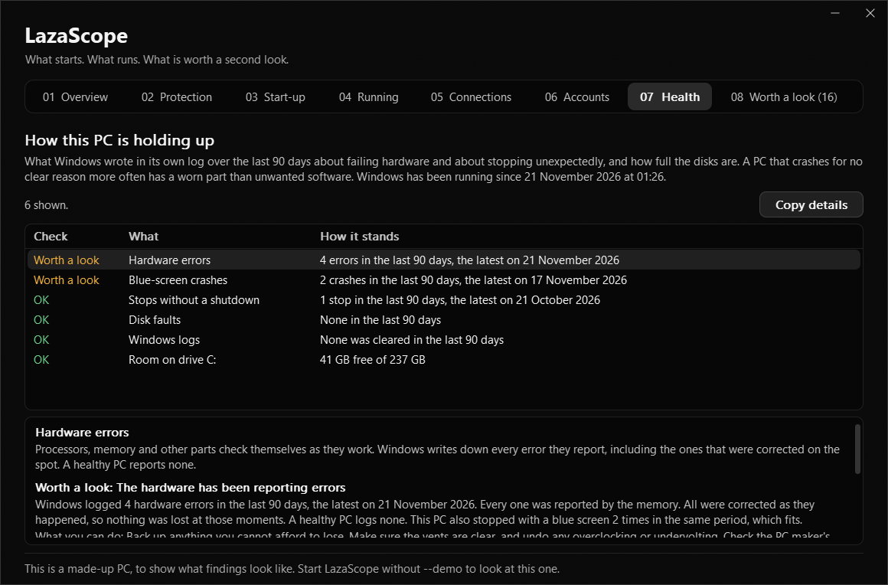
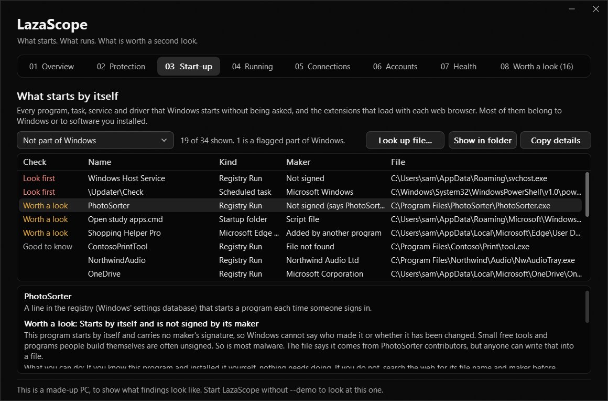

<p align="center"></p>

<h1 align="center">LazaScope</h1>
<p align="center">What starts. What runs. What is worth a second look.</p>

<p align="center">
  
  
  <a href="LICENSE"></a>
</p>

**LazaScope is a portable Windows utility that shows what a PC is doing and points out anything worth a second look, in plain English.** It lists what starts by itself, what is running, what is talking to the network, whether the PC's protections are on and how the hardware is holding up, and gives a written reason for everything it flags. It only reads: nothing on the PC is changed. Nothing leaves the PC either, unless you press the one button that looks a file up online and then say yes.

[Download the latest Windows release](https://github.com/kimineechan/LazaScope/releases/latest) · [Usage guide](docs/USAGE.md) · [The rules](docs/RULES.md) · [Report a bug](https://github.com/kimineechan/LazaScope/issues/new/choose)

<p align="center"></p>

The pictures on this page show a made-up PC, which LazaScope displays when started with `--demo`.

## Features

| Feature | What it does |
| --- | --- |
| Overview | Six lights: Protection, Starts with Windows, Running now, Internet connections, Accounts and remote access, PC health |
| Start-up list | Every Run entry, Startup folder item, Store app, scheduled task, service and driver that starts by itself, with its maker, its file and what it is |
| Browser extensions | The extensions in Chrome, Edge, Firefox, Brave, Vivaldi and Opera: where each came from and what it may do |
| Scripts, read | For a script that starts by itself: what its text shows it doing, and how it begins |
| Running programs | Every running program as a family tree that shows what started what, with the command that started it |
| Connections | Each open connection and each port a program is waiting on, with the program it belongs to. An address is shown by name where Windows remembers the name that was looked up |
| Protection | Antivirus, firewall, User Account Control, Windows updates, disk encryption, Secure Boot, the hosts file, the name servers (DNS) the PC asks, and the proxy setting |
| What the antivirus found | From Microsoft Defender's own log: what it caught in the last 90 days, and the places it was told to skip, with the date each was added. Needs no administrator rights |
| Accounts and remote access | Administrator accounts, Guest, automatic sign-in, Remote Desktop and remote-control software |
| PC health | From Windows' own log: errors the hardware reported about itself, blue screens with their stop codes, disk faults, cleared logs, and free room on the disks |
| What is new | **Compare with a report...** holds a look against one you saved earlier. **Watch for a minute** keeps looking, so that a program that starts, connects and is gone again in seconds is still seen |
| Fingerprints | A SHA-256 fingerprint for every flagged file. **Look up file...** offers to open VirusTotal's page for a file's fingerprint in your own browser |
| Worth a look | Forty-four written rules. Every flag comes with the reason and with what you can do about it |
| Signatures, checked properly | Who signed each file, including the many Windows files whose signature is kept in a separate catalogue |
| Report | One self-contained web page, plain text, or JSON with every fact as it was read, to keep or to send to someone who is helping you |
| Demo | `--demo` shows a made-up PC, so you can see what findings look like without having any |
| Command line | Run the same engine from a terminal with `lazascope-cli.exe` |
| Dark, see-through window | Black, with rounded controls and a blurred view of what is behind it. LazaScope draws it itself, with no web view or interface toolkit |
| Portable, local and read-only | No installer, no network client, no telemetry. It works without administrator rights and says plainly what it could not read |

"A fingerprint" is a long number worked out from every byte of a file. Two files with the same fingerprint are the same file, so a file can be looked up by it without being sent anywhere.

## Why

To answer "is this PC all right?", people who know Windows well open several tools: one for what starts by itself, one for what is running, one for network connections and one for digital signatures. Each prints hundreds of rows meant for specialists, and none of them says in plain words what is normal.

LazaScope reads the same information from Windows and puts it on one page. It explains each thing it lists, and it flags the things that are unusual with the reason written out.

## What counts as worth a look

Every flag comes from a written rule, so LazaScope can always say why. These are the main ones. The full list, with the reasoning for each, is in [The rules](docs/RULES.md).

| Sign | Why it matters |
| --- | --- |
| Something that starts by itself has no valid digital signature | Real software is nearly always signed by its maker. An unsigned program cannot be traced to anyone |
| It runs from a temporary or download folder | Installed software lives in Program Files. Malware often runs from folders any program may write to |
| It is named like a part of Windows but is in the wrong folder | A classic disguise, such as a fake `svchost.exe` |
| A start-up entry runs a scripting tool with a scrambled command | Attackers hide their instructions this way |
| A script starts by itself from outside Windows and Program Files | Scripts are almost never signed, and anything able to change the file can rewrite it |
| A "debugger" is set for a normal program | A trick that swaps one program for another |
| A task or service runs from a user's own folder | Unusual for real software, and the file can be swapped by any program that user runs |
| The hosts file sends names somewhere else | That file can silently redirect or block websites |
| Antivirus or firewall is off, or folders are excluded from scanning | Malware often switches these off first |
| Remote-control software is installed or running | Fine if you installed it. Worth knowing if you did not |
| An unsigned program is waiting for incoming connections | A possible back door |
| A start-up entry points at a file that is gone | A harmless leftover, worth tidying |
| A browser extension did not come from the browser's store, or is forced on by a policy | It skipped the store's checks, or cannot be removed from inside the browser |
| The antivirus found something lately, or its own log shows a place it was told to skip | Worth knowing where the file came from, and who added the exclusion |
| Website names are looked up through a server someone typed in, or web traffic goes through a proxy | Whoever runs either can see where this PC goes, and decide where it ends up |
| The hardware has been reporting errors, or Windows keeps stopping with a blue screen | A failing part causes crashes that look like software trouble |
| A Windows log was wiped | Rare in everyday use. It removes the record of what happened |

**Worth a look does not mean harmful.** The same signs that mark an intruder also mark plenty of honest software: a small free tool is often unsigned, and a program you built yourself always is. LazaScope gives the reason and leaves the judging to you.

## Download and run

1. Open [Releases](https://github.com/kimineechan/LazaScope/releases).
2. Download `LazaScope-v1.0.0-windows-x64.zip`.
3. Extract the ZIP and open `LazaScope.exe`.

LazaScope targets **64-bit Windows 10 and Windows 11**. It needs no Go, Python, Node, or separate application framework.

Release assets include `SHA256SUMS.txt`. Check the ZIP in PowerShell with:

```powershell
Get-FileHash .\LazaScope-v1.0.0-windows-x64.zip -Algorithm SHA256
```

Compare the result with its entry in `SHA256SUMS.txt`.

## Take a look

1. Open `LazaScope.exe`. It looks at the PC straight away, which takes a few seconds.
2. Read the six lights on **01 Overview**. Green means nothing stands out, amber means something is worth a look, red means look at this first, and a ring means that part could not be read.
3. Open **08 Worth a look** for everything the rules flagged, the most serious first. Select a row to read why it was flagged and what you can do.
4. Open the other sections to see everything LazaScope read, flagged or not.

<p align="center"></p>

Select **Save report...** to keep the result as one file. The report names the PC, the account in use, the programs it runs and the sites and addresses they talk to, so read it before you send it to anyone.

To see what has changed on a PC, save a report as data (.json) today. Another day, press **Compare with a report...** and choose it: what was not there then is marked **New**, and what is gone or has changed is listed. To catch what comes and goes, press **Watch for a minute**.

See the [usage guide](docs/USAGE.md) for each section, the report, the command-line tool and what administrator rights add.

<p align="center"></p>

## What it reads

LazaScope does not include or call Microsoft's Sysinternals tools or any other program. It asks Windows directly:

- **Start-up:** the registry's `Run` and `RunOnce` lists for the PC, for the account, and for the other accounts whose settings are loaded, as 64-bit and as 32-bit programs see them; both Startup folders; the start-up tasks of Store apps; every scheduled task; services and drivers set to start automatically; the sign-in settings `Shell` and `Userinit`; debugger settings; and `AppInit_DLLs`. It also reads Task Manager's on and off switches, so its list matches the Start-up tab. The browsers' extensions come from the browsers' own record files, which are opened for reading. No browser is started.
- **Running programs:** the path, command line, parent, account and start time of each, and the services inside each host program.
- **Connections:** Windows' own table of TCP and UDP connections and waiting ports, with the program that owns each. The names come from Windows' note of recent lookups, the one `ipconfig /displaydns` shows. LazaScope asks for what Windows remembers and makes no lookup of its own.
- **Protection:** Windows Security's verdict on antivirus and firewall, Microsoft Defender's settings and exclusions, User Account Control, the last installed update, disk encryption, Secure Boot, Remote Desktop, the Administrators group, the hosts file, the name servers and proxy in use, and the list of installed apps.
- **Windows' own logs:** the System log for hardware errors, blue screens, disk faults and cleared logs, and Microsoft Defender's log for what it found and how its settings changed.
- **Scripts:** a script that starts by itself is opened and read as text, up to 2 MB. It is never run.
- **Signatures:** Windows' own signature check, for a signature inside the file and for one in a catalogue.

<p align="center"></p>

## Compatibility and limits

- **LazaScope is not an antivirus, and it removes nothing.** It shows what is there and what is unusual. Acting on it is up to you.
- **It cannot see software that hides inside the core of Windows** (a "rootkit"). Such software can hide from every program that asks Windows what is running, and LazaScope is one of those.
- **A clean result is not proof that nothing is wrong.** LazaScope only knows the signs it was taught.
- It covers the start-up places that matter most, and browser extensions. Windows has well over a hundred such places, and the rest are not read in this version.
- Without administrator rights it cannot read the list of folders Microsoft Defender skips, the scheduled tasks Windows shows to administrators only, the start-up lists of other accounts, the command lines and accounts of programs that run as other accounts, or a few protected services. It says so on the page where each belongs. **Look again as administrator** reads these too.
- **Look up file...** is the one thing that reaches the internet, and it is your browser that does it. LazaScope works out the file's fingerprint, shows it to you and asks. On a yes it opens VirusTotal's page for that fingerprint. The file itself is never sent.
- **Watch for a minute** reads the list of programs and connections once a second. A program that lives for less than a second can slip between two readings, and LazaScope sees that a connection exists, not what is said over it.
- The health page reports what Windows wrote in its log. A fault that Windows never noticed is not in it, and a log that was cleared holds nothing from before.
- A script is read for a list of things it can be seen to do. A script can hide what it does, so an empty list is not a clean bill.
- Signatures are checked without going online. A certificate that this PC has never met before can therefore show as not trusted, and a certificate that was withdrawn after signing is not noticed.
- An address has a name only where Windows remembers the lookup. Browsers that do their own lookups leave nothing there, so many addresses stay numbers. Looking them up would mean sending them to a name server.
- Signatures are checked on programs. A script can carry one too, though almost none does, and LazaScope does not look for it.
- It reads what Windows reports. A setting that Windows reports wrongly is shown wrongly.
- Tested on Windows 10. See [VALIDATION.md](VALIDATION.md) for what was checked and where the checking stops.
- The executables are unsigned, so Windows SmartScreen may ask for confirmation the first time. For the same reason LazaScope would flag a copy of itself that is set to start with Windows.

## Build from source

Install [Go](https://go.dev/dl/) 1.25 or newer, clone the repository, and open a terminal in its root:

```powershell
git clone https://github.com/kimineechan/LazaScope.git
cd LazaScope
.\build.cmd
```

The results are `dist\LazaScope.exe` and `dist\lazascope-cli.exe`. The build script runs `go vet` and the tests, builds both programs, then runs the check described below.

The last step, `cmd/verify`, plants eleven harmless items in your own account. An antivirus may stop it, because planting start-up entries is what an antivirus watches for: `go run ./cmd/verify --clean` then removes whatever was left. Ten look suspicious, such as a copy of Notepad named `svchost.exe` in the temporary folder with a line in your `Run` list, and one does not. It checks that LazaScope flags each of the ten for the right reason and leaves the eleventh alone, removes them all and checks that none is left. It touches nothing outside your own account and needs no administrator rights.

The project uses the Go standard library and native Windows APIs. No third-party Go modules are required. The icon and the Windows resources are generated by `tools/mkres`, which is also plain Go.

Create the release ZIP after building:

```powershell
.\scripts\package.ps1
```

See [CONTRIBUTING.md](CONTRIBUTING.md) for development checks and [docs/GITHUB.md](docs/GITHUB.md) for release publishing.

## How it works

LazaScope has three parts that know nothing of each other's insides.

**Collectors** read facts from Windows: one for start-up entries, one for running programs, one for connections, one for protection and one for the health of the PC. Each start-up command is followed to the file that really does the work. For `rundll32.exe thing.dll,Start` that is the library, not `rundll32`, and for a service inside `svchost.exe` it is the service's own library.

**The signature checker** asks Windows who signed each of those files. Many of Windows' own files carry no signature inside them: their fingerprints are listed in signed catalogues. A check that skips the catalogues calls most of Windows unsigned, and every rule built on it would raise false alarms, so the checker looks in both places. It remembers each answer, which is why a few hundred files take a second or two.

**The rules** are plain functions over the collected facts. They call nothing and read nothing, so each one is tested with made-up PCs, including the cases where it must stay quiet. A rule returns a finding with a title, the reason, what to do and the evidence.

A fault inside one collector does not end the look. That part is left out, its light shows a ring, and the page says that it could not be read and why.

The window and the report show the same pages, built once from the facts and the findings.

Implementation details and checks are in [VALIDATION.md](VALIDATION.md).

## Contributing and licence

Bug reports, false alarms, things LazaScope missed, and focused pull requests are welcome. Please read [CONTRIBUTING.md](CONTRIBUTING.md).

MIT licence. See [LICENSE](LICENSE). The Go runtime and standard library notice is included in [THIRD-PARTY-NOTICES.txt](THIRD-PARTY-NOTICES.txt).
