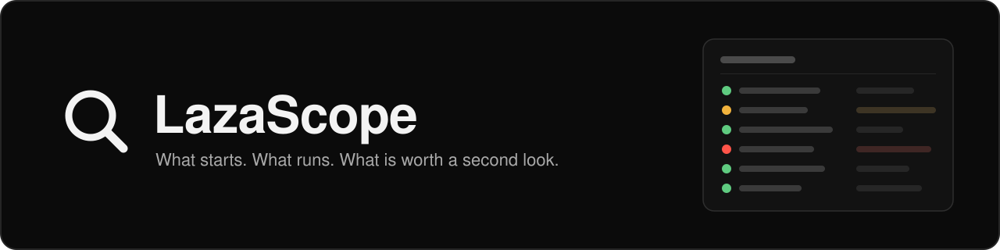
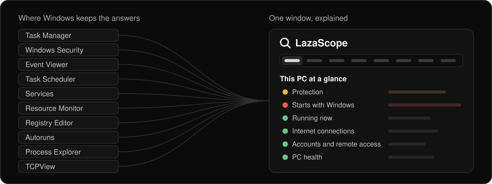
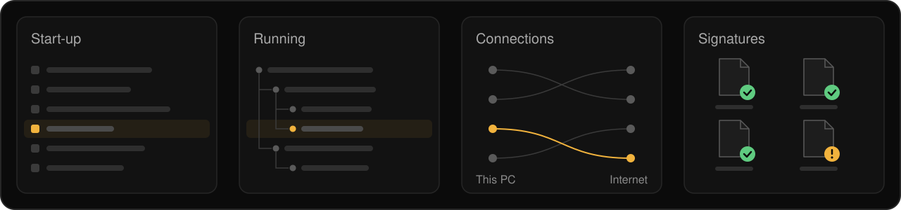
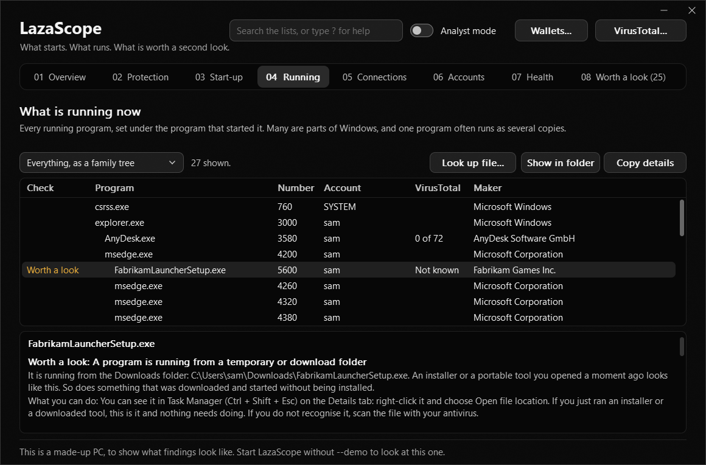
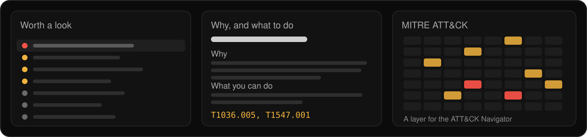
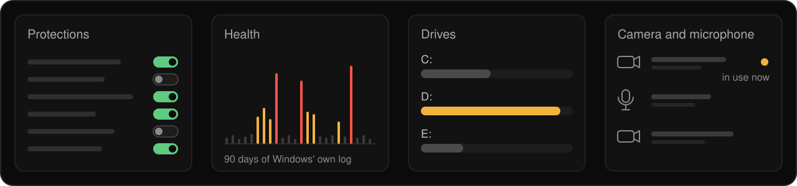
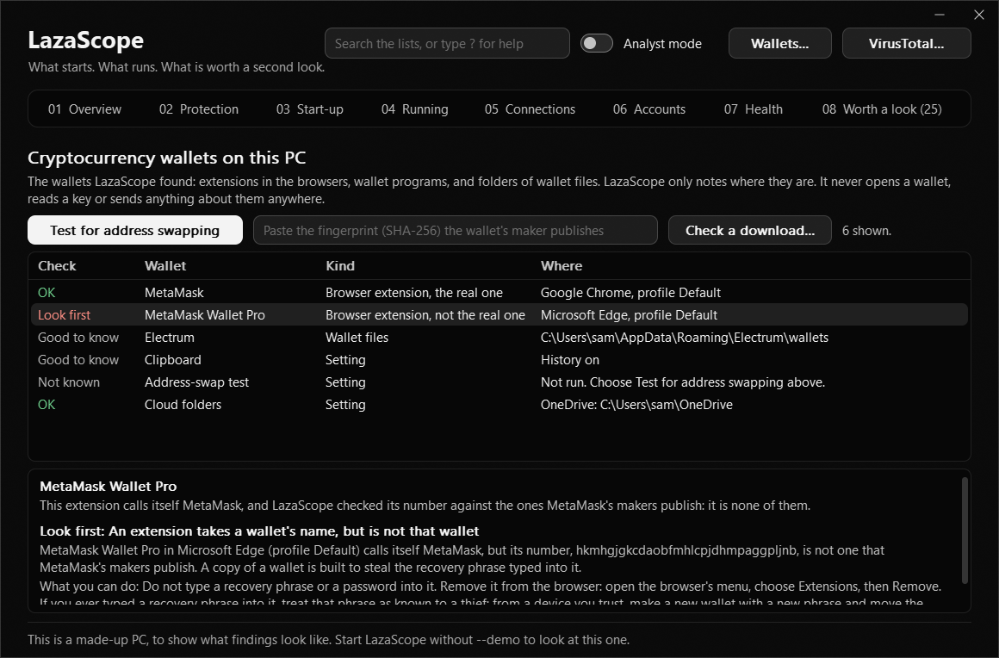
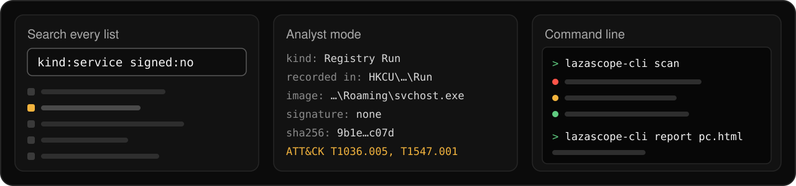
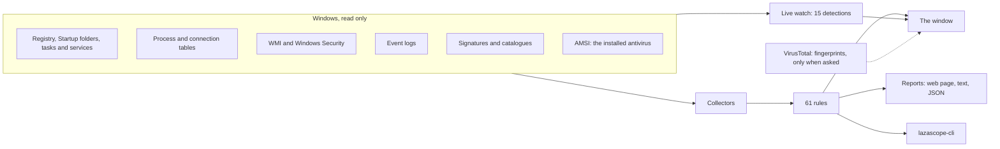

<p align="center">
  
</p>

<p align="center">
  <b>It reads, it explains, and it changes nothing.</b><br>
  A free, portable Windows program that shows what your PC is doing and explains anything worth a second look, in plain English.
</p>

<p align="center">
  <a href="https://github.com/kimineechan/LazaScope/releases/latest"></a>
  
  <a href="LICENSE"></a>
</p>

<p align="center">
  <a href="#download-and-run">Download</a> ·
  <a href="#features">Features</a> ·
  <a href="#when-to-use-it">When to use it</a> ·
  <a href="#privacy-and-safety">Privacy</a> ·
  <a href="#documentation">Docs</a>
</p>


<p align="center"><sub>Every picture on this page shows a made-up PC, which LazaScope displays when started with <code>--demo</code>.</sub></p>

## Why LazaScope

Windows can already answer most of the questions people ask when a PC misbehaves, but the answers are spread across a dozen places. Task Manager shows what is running, not what started it or whether it should be there. Windows Security says whether the antivirus is on, not which folders it was told to skip. Event Viewer holds every blue screen among tens of thousands of other entries, and Microsoft's Sysinternals tools go deeper still, in hundreds of rows written for specialists. None of them tells you what is normal.

LazaScope reads the same information from Windows, puts it in one window, says what each thing is, and flags what stands out using written rules, so it can always say why.

<p align="center">
  
</p>

- **One window instead of many.** What starts by itself, what is running, what is connected, how the PC is protected, who can get in and how the hardware is holding up.
- **A reason for everything it flags.** 61 written rules, each with why it matters and what you can do, the most serious first.
- **Read-only by design.** It cannot stop a program, delete a start-up entry or switch a setting on. When something needs doing, it says where to do it in Windows.
- **Nothing leaves the PC unless you ask.** Looking a file up on VirusTotal, with a key of your own, sends its fingerprint, never the file.
- **Portable.** One program, nothing to install, and no administrator rights needed.
- **For helpers and analysts too.** A report to email, a comparison with an earlier look, the exact evidence behind every row, MITRE ATT&CK numbers and a command-line tool.

<details>
<summary>Where each answer lives in Windows, and in LazaScope</summary>

| The question | Where Windows answers it | Where LazaScope answers it |
| --- | --- | --- |
| What starts by itself? | Task Manager's Start-up tab, Services, Task Scheduler, Autoruns | 03 Start-up |
| What is running, and what started it? | Task Manager, Process Explorer | 04 Running |
| What is connected to the internet? | Resource Monitor, `netstat -abno`, TCPView | 05 Connections |
| Is the PC protected? | Windows Security, `Get-MpPreference`, BitLocker settings, System Information | 02 Protection, Protections to switch on |
| Who can get in? | Computer Management, Remote Desktop settings | 06 Accounts |
| Is the hardware failing? | Event Viewer, Reliability Monitor | 07 Health |
| Who made this file? | A file's Properties > Digital Signatures, Sigcheck | Every list |
| What did Defender find, and what was it told to skip? | Windows Security's Protection history and Exclusions | 02 Protection |
| What ran lately, and where did a download come from? | Registry Editor and PowerShell, if you know where to look | Timeline |
| Which apps used the camera or microphone? | Settings > Privacy and security (Privacy on Windows 10) | Camera and microphone |
| What is starting right now? | Process Monitor, Sysmon | Watch programs start |

</details>

### What it isn't

- **Not an antivirus.** It removes nothing and blocks nothing.
- **Not a verdict.** "Worth a look" means unusual, not harmful: plenty of honest software is unsigned or runs from an odd folder. A clean result means none of the signs LazaScope knows was seen, not that nothing is wrong.
- **Not a rootkit finder.** Software that hides inside the core of Windows can hide from LazaScope, as it can from any program that asks Windows what is running.
- **Not Microsoft's.** LazaScope is not made by or connected with Microsoft, and it contains, downloads and runs none of Microsoft's tools. It asks Windows for the same information itself.
- **Not tested everywhere yet.** It is made for 64-bit Windows 10 and 11, and tested on Windows 10.

## Deutsch

LazaScope gibt es in dieser Fassung auch auf Deutsch. Die Sprache folgt Windows, oder wird
ausdrücklich gewählt:

```
LazaScope.exe --lang de
lazascope-cli scan --lang de
```

Alternativ die Umgebungsvariable `LAZASCOPE_LANG=de` setzen. Ohne Angabe gilt die Windows-Sprache;
ist sie nicht Deutsch, bleibt alles englisch. Fehlt eine Übersetzung, erscheint der englische Text.

Die Übersetzungen liegen in `internal/i18n/de.json` (englischer Text als Schlüssel, deutscher als
Wert) und werden mit `go:embed` in das Programm eingebettet. Neue Texte im Code gehen durch
`i18n.T(...)`; ohne Eintrag bleiben sie englisch.
## Download and run

1. Download `LazaScope-v1.0.1-windows-x64.zip` from the [latest release](https://github.com/kimineechan/LazaScope/releases/latest).
2. Extract it and open `LazaScope.exe`. There is nothing to install.
3. LazaScope looks at the PC straight away. Start at **08 Worth a look**.

It needs no administrator rights. Without them a few things cannot be read, and LazaScope says which; **Look again as administrator** reads them too. To see what findings look like, start it with `--demo` for a made-up PC.

> [!NOTE]
> The programs are not code-signed, so the first time you run one, Windows SmartScreen may say it does not recognise the app: choose **More info**, then **Run anyway**.
>
> On Windows 11, **Smart App Control** goes further. Where it is switched on, it blocks programs that are not code-signed unless Microsoft's cloud service already knows them, with no way to allow one program, so Windows may refuse to open LazaScope at all. Windows Security, App and browser control, Smart App Control settings shows whether it is on. Switching a protection off to run LazaScope is not worth it.

To check the download, compare its fingerprint with the one in `SHA256SUMS.txt`:

```powershell
Get-FileHash .\LazaScope-v1.0.1-windows-x64.zip -Algorithm SHA256
```

## Features

### What starts, what runs, what connects

<p align="center">
  
</p>

- **Start-up:** every Run entry, Startup folder item, scheduled task, service, driver, Store app and browser extension that starts by itself, with its maker and its file. Each is followed to the file that does the work, such as the library behind `rundll32` or the script behind PowerShell.
- **Running:** every program as a family tree, with its account, its maker and the command that started it. Encoded PowerShell commands are turned back into text, and scripts and hidden commands are handed to the installed antivirus through Windows' AMSI.
- **Connections:** every connection and every port a program waits on, with its program and the far end by name where Windows remembers the lookup, and the name servers and proxy the PC uses.
- **Signatures:** who signed each file, checked inside the file and in Windows' catalogues, where most of Windows' own files keep theirs.



### Worth a look

<p align="center">
  
</p>

- **61 written rules** flag what stands out, the most serious first, each with the reason and what you can do. All of them are listed in [RULES.md](docs/RULES.md).
- **MITRE ATT&CK.** Findings name the techniques they may be a trace of, and **Save ATT&CK layer...** writes a layer for MITRE's ATT&CK Navigator.
- **VirusTotal,** with a free key of your own: what about 70 antivirus engines say about each program that starts or runs. Only fingerprints are sent.


<p align="center"><sub>Here a program named <code>svchost.exe</code>, the name of a part of Windows, runs from a folder where Windows never keeps it.</sub></p>

### Protection and health

<p align="center">
  
</p>

- **Protection:** the antivirus and firewall as Windows Security reports them, Defender's settings and the folders it was told to skip, User Account Control, updates, disk encryption, Secure Boot, the hosts file, Remote Desktop, the administrators and remote-control software.
- **Protections to switch on:** the ones Windows and Defender already have, whether each is on, what it does and where to switch it on, and how ready the PC is for ransomware.
- **Health:** errors the hardware reported about itself, each blue screen with its stop code, disk faults, cleared logs and how full each disk is, from Windows' own logs.
- **Camera and microphone:** which programs used them, and when, from Windows' own record.


### Timeline and wallets

- **Timeline:** everything LazaScope can date, newest first: programs started and opened, downloads and the website each came from, what Defender did, hardware errors and blue screens.
- **Wallets:** fake wallet extensions that copy a real wallet's name, a test for malware that swaps a copied wallet address for a thief's, and a check of a wallet installer against the fingerprint its maker publishes.
- **Recovery phrases:** **Find recovery phrases...** finds a crypto recovery phrase saved in a file and says where it is, never the words.



### For helpers and analysts

<p align="center">
  
</p>

- **Search every list,** by words or by fields such as `kind:service signed:no` or `attack:T1547.001`.
- **Analyst mode** adds the exact evidence to every row: paths, registry places, codes and times in UTC.
- **Watch programs start,** live, each checked against [15 detections](docs/DETECTIONS.md) written as code, such as Word starting PowerShell.
- **Reports** as one web page, plain text or JSON, and **Compare with a report...** to mark everything that is new since a saved one.
- **A command-line tool,** `lazascope-cli.exe`, with the same checks:

```powershell
.\lazascope-cli.exe scan                 # the six lights and everything worth a look
.\lazascope-cli.exe report pc.html       # save the report (.html, .txt or .json)
.\lazascope-cli.exe compare before.json  # what has changed since a saved report
.\lazascope-cli.exe phrases              # recovery phrases saved in files
.\lazascope-cli.exe live 120             # watch programs start for two minutes
```

`lazascope-cli help` lists every command. More pictures: [Start-up](docs/screenshots/startup.png), [Protection](docs/screenshots/protection.png), [Connections](docs/screenshots/connections.png), [Protections to switch on](docs/screenshots/protections.png), [Timeline](docs/screenshots/timeline.png), [VirusTotal](docs/screenshots/virustotal.png), [Camera and microphone](docs/screenshots/devices.png).

## When to use it

- **A PC has started acting strangely.** Slow for no reason, fans at full speed, pop-ups, a browser home page you did not choose. Start at 08 Worth a look: 04 Running shows what started what, 05 Connections what it talks to, and 03 Start-up how it comes back after a restart.
- **You have bought, inherited or been handed a PC.** Look for remote-control software someone left behind, an administrator account you did not make, folders the antivirus was told to skip, and old programs still set to start.
- **Someone asks you for help over the phone.** Ask them to press **Save report...** and email you the page. It names the PC and the programs on it, so they should read it first.
- **You are about to install something.** Save a report as data, install, then press **Compare with a report...**: everything the installer added is marked New.
- **Blue screens, freezes or sudden restarts.** 07 Health lists the errors the hardware reported about itself and each blue screen's stop code. A failing part often looks like a software problem.
- **You keep cryptocurrency on this PC.** The Wallets page looks for fake wallet extensions, address-swapping malware and recovery phrases saved in files.
- **You opened something you should not have.** The Timeline shows what ran and what was downloaded around that time. Save a report before cleaning anything up, for whoever helps you.
- **You are learning security, or working in it.** Analyst mode, ATT&CK numbers, Navigator layers, JSON reports and the command-line tool.

## How it works

LazaScope asks Windows for everything it shows, the way Windows' own tools do, and opens nothing it does not need. A look takes a few seconds. [How it works](docs/HOW-IT-WORKS.md) describes where each fact comes from, and its limits.

<details>
<summary>Diagram</summary>



</details>

## Privacy and safety

- **Read-only.** Nothing on the PC is changed, stopped or deleted, with or without administrator rights.
- **Nothing leaves the PC unless you ask.** The one exception is VirusTotal: with a key of your own, and only when you ask, LazaScope sends each file's fingerprint (a SHA-256 number worked out from the file's bytes), never the file. In the code, only one package can reach the network, and a test fails if any other tries.
- **Nothing is kept** apart from what you choose to save: a report, and with VirusTotal, your key (locked to your Windows account) and VirusTotal's answers, in LazaScope's folder inside AppData.
- **Built in the open.** GitHub builds every release from the public source, and the programs come out byte for byte the same as a build of the same source on a PC, so anyone can check them. What was tested, and how, is in [VALIDATION.md](VALIDATION.md).

## Documentation

| Document | What it covers |
| --- | --- |
| [Usage guide](docs/USAGE.md) | Every page, button and command |
| [How it works](docs/HOW-IT-WORKS.md) | Where each fact comes from, and the limits |
| [Rules](docs/RULES.md) | The 61 rules: what each flags, why, and its ATT&CK number |
| [Detections](docs/DETECTIONS.md) | The 15 detections the live watch uses |
| [Validation](VALIDATION.md) | What was tested, and how |
| [Changelog](CHANGELOG.md) | What changed in each version |
| [Contributing](CONTRIBUTING.md) | Building, testing and the planted-items check |

## Build it yourself

Install [Go](https://go.dev/dl/) 1.25 or newer, then:

```powershell
git clone https://github.com/kimineechan/LazaScope.git
cd LazaScope
.\build.cmd
```

This runs the checks and the tests and builds `dist\LazaScope.exe` and `dist\lazascope-cli.exe`. The last step plants twelve harmless test items in your own account, checks that LazaScope flags the right ones for the right reasons, and removes them again. [CONTRIBUTING.md](CONTRIBUTING.md) explains it, and what to do if your antivirus stops it.

The code uses only Go's standard library and Windows' own interfaces.

## Licence

MIT. See [LICENSE](LICENSE). The programs include the Go runtime and BIP 39's English word list, whose notices are in [THIRD-PARTY-NOTICES.txt](THIRD-PARTY-NOTICES.txt).
